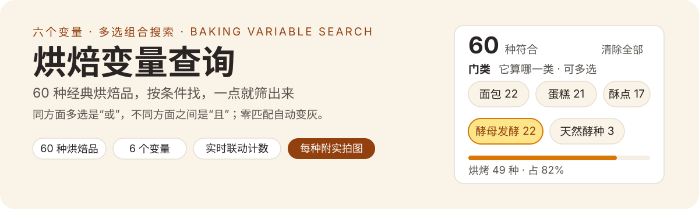
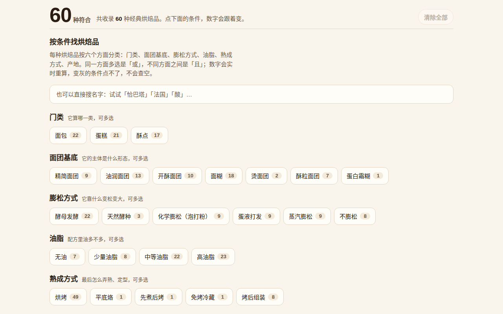
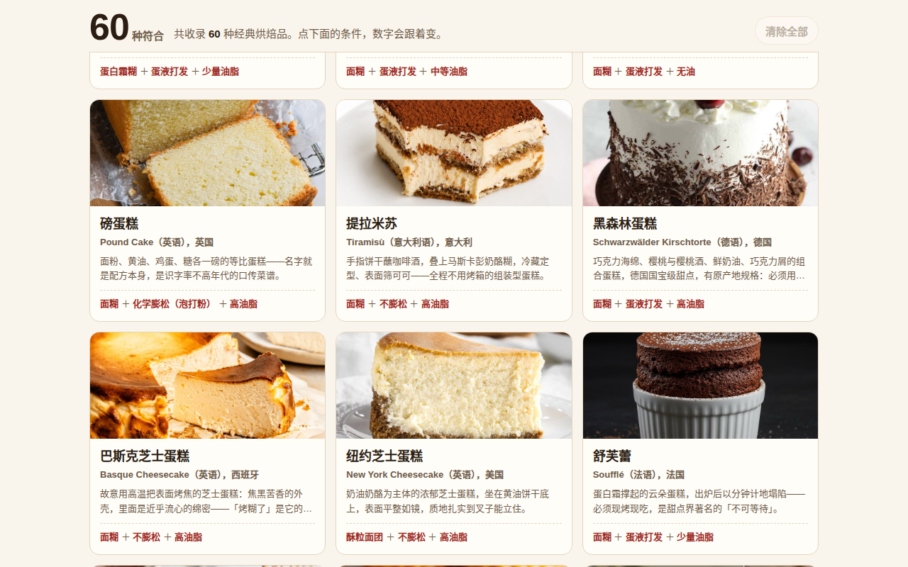

<p align="right"><a href="README.md">中文</a></p>

<p align="center">
  
</p>

<p align="center">
  <a href="https://holynova.github.io/baking-variable-search/">▶ Try Online</a>
  ·
  <a href="https://github.com/holynova/baking-variable-search">GitHub Repository</a>
</p>

A search tool for 60 classic baked goods, filtered by six variables — category, dough base, leavening, fat level, cooking method, and origin. Multi-select within one variable means OR; across variables means AND. Counts update live as you select, and options with zero matches are greyed out automatically, so you never get an empty result. Each item includes a photo, origin, and key notes.

## Screenshots

<p align="center">
  
</p>
<p align="center">
  
</p>

## Six Variables

| Variable | Options | Distribution |
|---|---|---|
| 门类 Category | 面包 bread / 蛋糕 cake / 酥点 pastry | 22 / 21 / 17 |
| 面团基底 Dough base | 精简 lean / 油润 enriched / 开酥 laminated / 面糊 batter / 烫面 scalded / 酥粒 crumb / 蛋白霜糊 meringue batter | 9 / 13 / 10 / 18 / 2 / 7 / 1 |
| 膨松方式 Leavening | 酵母发酵 yeast / 天然酵种 natural starter / 化学膨松 chemical leavening / 蛋液打发 whipped eggs / 蒸汽膨松 steam / 不膨松 unleavened | 22 / 3 / 9 / 9 / 9 / 8 |
| 油脂 Fat | 无油 no fat / 少量 low / 中等 medium / 高油脂 high | 7 / 8 / 22 / 23 |
| 熟成方式 Cooking method | 烘烤 baking / 平底烙 griddle / 先煮后烤 boil-then-bake / 免烤冷藏 no-bake chilled / 烤后组装 bake-then-assemble | 49 / 1 / 1 / 1 / 8 |
| 产地 Origin | France, Italy, Germany, UK, US, Japan, China and 10 more (17 regions) | — |

You can also search by name: try 「恰巴塔」 (ciabatta), 「法国」 (France), or 「酸」 (sour).

## What's in Each Card

- **Photo**: one photo per item (60 in `assets/img/`).
- **Name & origin**: Chinese name, original name and language, and origin (e.g. 法棍 Baguette, France).
- **Key notes**: ingredients, texture, how to eat it, and storage tips.
- **Comparison tip**: how it differs from a similar item (e.g. baguette vs ciabatta: low hydration with fine, even holes vs high hydration with large, wild holes).
- **Variable tags**: the item's value on each of the six variables — its "recipe profile" at a glance.

## Run Locally

A pure static single page — just open `index.html`, or serve it statically:

```bash
python3 -m http.server 8000
# Open http://localhost:8000
```

## Tech

- Pure HTML + CSS + JS, zero build, zero dependencies; data is embedded in the `ITEMS` array in `index.html` (60 entries).
- Filter logic: OR within one variable, AND across variables, with live count updates; zero-match options are disabled automatically.

```
index.html          Single-page app: data + filter logic + rendering
assets/img/         60 photos of baked goods
assets/screenshot.png   Old mobile screenshot (kept)
```
