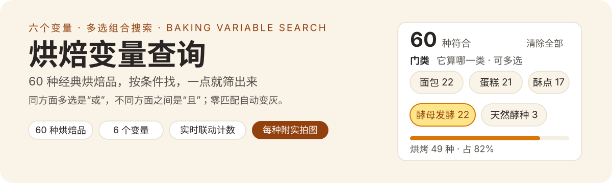
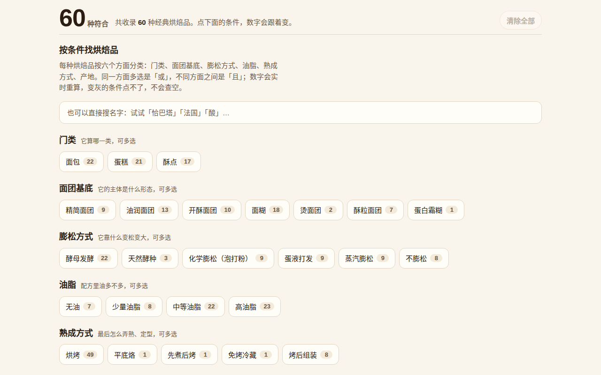
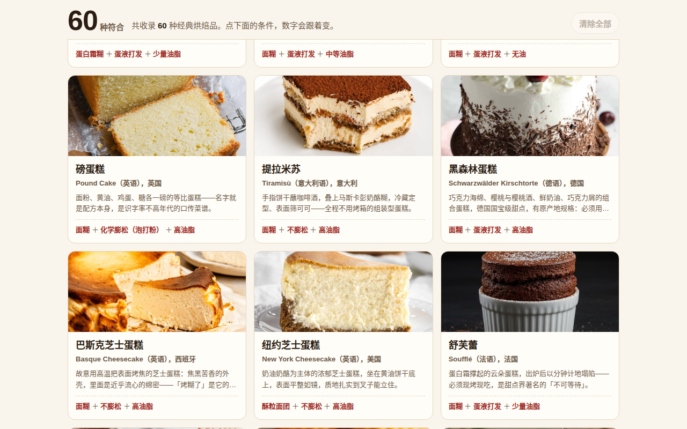

<p align="center">
  
</p>

<p align="center">
  <a href="https://holynova.github.io/baking-variable-search/">▶ 在线体验 Try Online</a>
  ·
  <a href="https://github.com/holynova/baking-variable-search">GitHub 仓库</a>
</p>

收录 60 种经典烘焙品，按六个变量多选组合搜索：门类、面团基底、膨松方式、油脂、熟成方式、产地。同一方面多选是"或"，不同方面之间是"且"；选中条件后其他选项的数字实时按"还能同时满足的"重新计算，零匹配的选项自动变灰点不了，不会出现查了个空的结果。每种烘焙品附实拍图、原产地与做法要点。

A search tool for 60 classic baked goods, filtered by six variables — category, dough base, leavening, fat level, cooking method, and origin. Multi-select within one variable means OR; across variables means AND. Counts update live as you select, and options with zero matches are greyed out automatically, so you never get an empty result. Each item includes a photo, origin, and key notes.

## 截图 / Screenshots

<p align="center">
  
</p>
<p align="center">
  
</p>

## 六个变量 / Six Variables

| 变量 | 选项 | 分布 |
|---|---|---|
| 门类 | 面包 / 蛋糕 / 酥点 | 22 / 21 / 17 |
| 面团基底 | 精简 / 油润 / 开酥 / 面糊 / 烫面 / 酥粒 / 蛋白霜糊 | 9 / 13 / 10 / 18 / 2 / 7 / 1 |
| 膨松方式 | 酵母发酵 / 天然酵种 / 化学膨松 / 蛋液打发 / 蒸汽膨松 / 不膨松 | 22 / 3 / 9 / 9 / 9 / 8 |
| 油脂 | 无油 / 少量 / 中等 / 高油脂 | 7 / 8 / 22 / 23 |
| 熟成方式 | 烘烤 / 平底烙 / 先煮后烤 / 免烤冷藏 / 烤后组装 | 49 / 1 / 1 / 1 / 8 |
| 产地 | 法国、意大利、德国、英国、美国、日本、中国等 17 个 | — |

也可以直接搜名字：试试「恰巴塔」「法国」「酸」。

## 每种烘焙品有什么 / What's in Each Card

- **实拍图**：60 种各一张（`assets/img/`）。
- **名字与出处**：中文名、原文名与语言、产地（如法棍 Baguette，法国）。
- **做法要点**：原料、质地、吃法与保存要点。
- **对比提示**：与相近烘焙品的区别（如法棍 vs 恰巴塔：低水孔细密 vs 高水孔大而野）。
- **变量标签**：该品种在六个变量上的取值，一眼看清它的"配方画像"。

## 本地运行 / Run Locally

纯静态单页，直接打开 `index.html` 即可；或起一个静态服务器：

```bash
python3 -m http.server 8000
# 打开 http://localhost:8000
```

## 技术 / Tech

- 纯 HTML + CSS + JS，零构建、零依赖；数据内嵌在 `index.html` 的 `ITEMS` 数组里（60 条）。
- 筛选逻辑：同变量 OR、跨变量 AND，计数实时联动，零匹配选项自动禁用。

```
index.html          单页应用：数据 + 筛选逻辑 + 渲染
assets/img/         60 张烘焙品实拍图
assets/screenshot.png   旧版移动端截图（保留）
```

## English

**Baking Variable Search** — find the baked good that fits your constraints. 60 classic items, each broken down into six variables: category (bread 22 / cake 21 / pastry 17), dough base (7 types), leavening (6 ways), fat level (4 levels), cooking method (5 ways), and origin (17 regions).

- **How filtering works**: multi-select within one variable is OR; across variables is AND. Every option shows a live count of "still satisfiable" items; options that would yield zero matches are greyed out and unclickable.
- **Each card** has a photo, original name and language, origin, key notes on ingredients and texture, and a comparison tip against a similar item (e.g. baguette vs ciabatta).
- **Run it**: pure static single page — open `index.html` directly or serve with `python3 -m http.server`. Zero build, zero dependencies.
